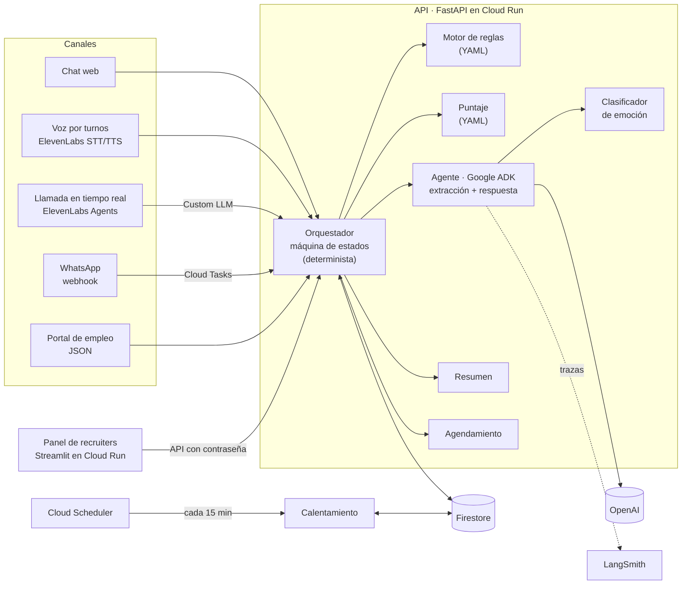
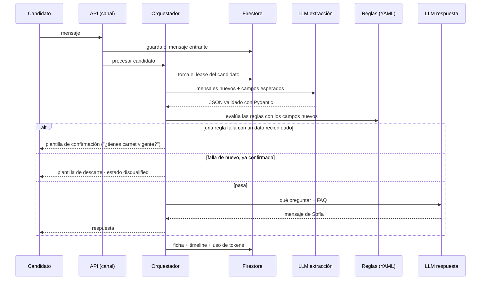
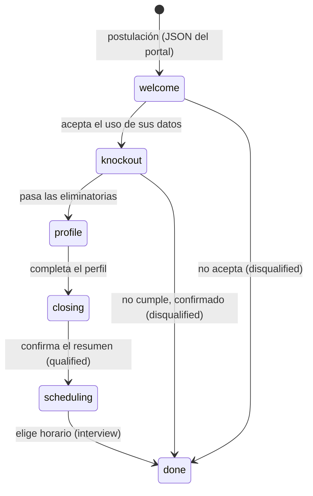
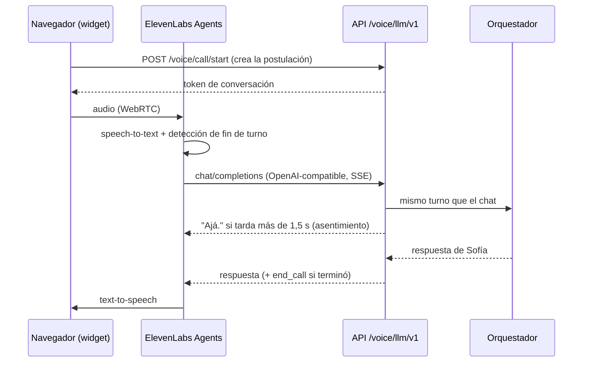

# Agente de screening de repartidores · Grupo Sazón

Agente conversacional que hace el primer filtro de candidatos a repartidor para Grupo Sazón
(45 locales en España y México, ~1.000 postulaciones por semana). Sofía, la asistente,
conversa con el candidato por chat, voz o WhatsApp:
- extrae y valida sus datos;
- aplica las reglas eliminatorias;
- calcula un puntaje;
- agenda la entrevista;
- deja una ficha lista para el recruiter en un panel que se actualiza en vivo.

**Demo en vivo:** <https://screening-panel-tg6cgmz3wa-ew.a.run.app>

| Página | Acceso | Qué es |
|---|---|---|
| **Postular (candidato)** | Pública | Pones nombre y país y conversas por chat con Sofía |
| **Hablar con Sofía (voz)** | Pública | El mismo screening por turnos de voz (grabas, Sofía responde con voz) |
| **Llamar a Sofía (tiempo real)** | Pública | Una llamada en el navegador, con interrupciones y cambio de idioma |
| **Panel (recruiter)** | Contraseña | La ficha se llena mientras conversas: datos, puntaje, conversación, resumen, agenda |

> El primer mensaje tras un rato sin uso tarda ~20 s: Cloud Run escala a cero para no cobrar.

**Para probarlo en 2 minutos:** abre *Postular* o *Llamar a Sofía* en una pestaña y el *Panel*
en otra. Responde las preguntas: puedes contestar con tus palabras, hacer preguntas sobre el
trabajo, cambiar a inglés, decir algo ambiguo o algo que te descarte. Mira cómo se arma la
ficha en el panel.

| Documento | Contenido |
|---|---|
| [docs/fase1_diseno_proceso.md](docs/fase1_diseno_proceso.md) | Fase 1: diseño del proceso (etapas, personalidad, campos, casos borde). Es la fuente de verdad del comportamiento |
| [docs/conversaciones_ejemplo.md](docs/conversaciones_ejemplo.md) | Conversaciones reales con el sistema: calificada, descartes, cambio a inglés, opt-out, frustración, ambigüedad |
| [docs/integracion_ats.md](docs/integracion_ats.md) | Diseño de la integración con un ATS |
| [docs/crm.md](docs/crm.md) | El panel de recruiters |
| [specs/](specs/README.md) | Una spec por feature (000–023): qué hace, criterios de aceptación y cómo se prueba |
| [evals/README.md](evals/README.md) | Pipeline de evaluación con LLM-as-a-judge |
| [deploy/README.md](deploy/README.md) | Despliegue en GCP paso a paso |
| [CLAUDE.md](CLAUDE.md) | Reglas de trabajo del repo (arquitectura, estilo, escalabilidad) |

---

## 1. El problema y la solución

Hoy 13 recruiters hacen ~975 llamadas por semana para ~1.000 postulantes:
- **El 60% no contesta.**
- **El 80% del tiempo restante se va en candidatos que no califican.**

En la práctica se habla con menos del 40% de los postulantes, y tarde, mientras Glovo, Uber
Eats y Rappi compiten por el mismo talento.

El diagnóstico es de **canal, orden y velocidad**, no solo de "automatizar llamadas":

| Problema | Respuesta |
|---|---|
| El 60% no contesta llamadas | **Mensajería asíncrona** a los minutos de postular (WhatsApp en producción; chat web en el demo), con **calentamiento automático** si no responde: recordatorios por WhatsApp y SMS en horario hábil |
| El 80% del tiempo en no calificados | **Eliminatorias primero** (consentimiento, licencia compatible con el vehículo, ciudad con local): quien no califica sale en un minuto, sin tocar a un humano |
| Llegar tarde | El recruiter recibe una **cola de calificados ordenada por puntaje**, con resumen y la entrevista ya agendada. Deja de filtrar y pasa a cerrar |

El recruiter solo interviene donde aporta: entrevistar y contratar.

## 2. Qué cubre

| Requisito del enunciado | Dónde |
|---|---|
| Agente conversacional que sigue el diseño de la Fase 1 | `src/screening/conversation/` (orquestador) + `src/screening/agent/` (Google ADK) |
| Salida JSON estructurada con todos los campos | `ScreeningData` en `src/screening/domain/models.py`; la salida del LLM usa JSON schema estricto y se valida con Pydantic |
| Validación: rechazar con amabilidad y repreguntar | Un campo inválido se repregunta con un ejemplo. Tras 2 intentos queda en `needs_review` y la conversación sigue |
| Historial completo | La ficha guarda cada mensaje y cada evento (`timeline`) en Firestore |
| Almacenamiento | Firestore (en memoria para tests y desarrollo) |
| Resumen post-conversación | `src/screening/summary/`: datos clave desde la ficha + observaciones del LLM |
| Manejo de errores | Ningún error del LLM, la base o el canal tumba la conversación: se registra y se pide disculpas |
| Herramienta para recruiters | Panel en Streamlit con: tabla paginada; ficha con conversación, JSON, puntaje y resumen; cambio de estado; agenda; métricas |

| Bonus | Estado |
|---|---|
| Multi-idioma ES/EN | ✅ Responde en el idioma del último mensaje, también a mitad de la conversación. Usa el vocabulario de cada país ("carnet"/"licencia", "coche"/"carro") |
| Guardrails | ✅ <ul><li>Las reglas nunca las decide el LLM.</li><li>Antes de descartar se confirma el dato.</li><li>Filtro de fugas de texto interno.</li><li>Opt-out respetado.</li><li>Pedido de humano.</li><li>La FAQ no se inventa.</li></ul> |
| Análisis de sentimiento | ✅ Clasificador con `gpt-5-nano` (frustrado / confundido / apurado / neutral) que ajusta el tono |
| Analítica | ✅ Completitud, abandono por etapa, motivos de descarte, duración y costo por candidato |
| Re-engagement | ✅ Cadencias en YAML (nunca respondió / abandonó a mitad), horario hábil por país, cancelación al responder |
| Base de conocimiento (FAQ) | ✅ Sofía responde dudas del trabajo con la FAQ de la empresa, y dice con naturalidad cuando algo no está |
| **Agente de voz** (tier "Great") | ✅ Dos modos sobre el mismo orquestador: <ul><li>voz por turnos con ElevenLabs STT/TTS (spec 020);</li><li>llamada en tiempo real con ElevenLabs Agents (spec 022).</li></ul> |
| Agendamiento de entrevistas | ✅ Al calificar, ofrece 3 horarios en la zona horaria del candidato y reserva el elegido de forma atómica. El recruiter reagenda o cancela desde el panel (spec 021) |
| Tests y evals | ✅ 1.022 tests unitarios + 6 suites con golden dataset y LLM-as-a-judge |
| Despliegue | ✅ Cloud Run, Firestore, Secret Manager, Cloud Scheduler y Cloud Tasks; trazas en LangSmith agrupadas por conversación |
| Integración con ATS | ✅ Diseño en [docs/integracion_ats.md](docs/integracion_ats.md) |

## 3. Arquitectura

### Vista general



Hay **dos servicios** en Cloud Run:
- **API** (`screening-api`, FastAPI): todo el comportamiento.
- **Panel** (`screening-panel`, Streamlit): las páginas públicas (chat, voz y llamada) y el panel
  del recruiter. No toca la base directamente: todo pasa por la API.

### El principio: el código decide, el LLM conversa

El orquestador es una **máquina de estados determinista**. En cada turno decide en código:
- qué dato falta;
- si una regla eliminatoria falla;
- cuánto puntaje tiene el candidato;
- cuándo se cierra la conversación.

El LLM tiene solo dos trabajos, en dos llamadas separadas:

| Turno | Entrada | Salida | Modelo |
|---|---|---|---|
| **Extracción** | Mensajes nuevos + contexto + campos esperados | JSON con esquema estricto: campos normalizados, inválidos, idioma, emoción, opt-out, pedido de humano, pregunta | `gpt-4.1-mini` |
| **Respuesta** | Lo que decidió el orquestador ("pregunta `city`", "repregunta `start_date`", "responde esta pregunta") + FAQ | El próximo mensaje de Sofía, 1–3 líneas, una sola pregunta | `gpt-5-mini` |

El mensaje al candidato nunca menciona campos ni herramientas internas: hay un filtro de fugas
que reintenta si pasa. Los textos que deciden algo importante son **plantillas fijas** en YAML:
- el primer contacto;
- los descartes;
- la confirmación antes de descartar;
- los recordatorios.

### Un turno de conversación



En el cierre:
1. Sofía muestra un resumen de los datos para confirmar.
2. Se calcula el puntaje y el estado pasa a `qualified`.
3. Sofía ofrece 3 horarios de entrevista.
4. Se reserva el horario elegido y el estado pasa a `interview`.
5. Se genera el resumen para el recruiter.

### Etapas y estados de la ficha



- **Estados** (`CandidateStatus`): `new` → `contacted` → `in_screening` → `qualified` →
  `interview` → `hired`.
- **Salidas laterales:** `disqualified`, `no_response`, `opted_out` e `invalid_data`.
- El recruiter puede cambiar el estado desde el panel. Cada cambio queda en el `timeline`
  con su motivo.

### Motor de reglas en YAML

Toda la lógica de negocio configurable vive en [`config/`](config) y el código no tiene
defaults de negocio:

| Archivo | Qué define |
|---|---|
| `rules/knockout.yaml` | Reglas eliminatorias. Cada una declara: <ul><li>`requires`: los campos que necesita;</li><li>una `condition`;</li><li>`reason_code`;</li><li>`message_template`: la plantilla de descarte;</li><li>`confirm_template`: la plantilla para confirmar antes de descartar.</li></ul> Se evalúa apenas están sus campos |
| `scoring.yaml` | Puntaje 0–100: experiencia 35, disponibilidad 25, fecha de inicio 20, vehículo propio 10, flexibilidad horaria 10 |
| `cadences.yaml` | Recordatorios por situación, horario hábil por país, qué hacer si responde o vuelve al silencio |
| `scheduling.yaml` | Agendamiento: ventanas por país, duración, antelación, horizonte, opciones por mensaje y recordatorios |
| `regions/es.yaml`, `regions/mx.yaml` | Ciudades con local, licencias válidas por vehículo, vocabulario y zona horaria |
| `templates.yaml` | Mensajes fijos por idioma |
| `client.yaml` | Nombre del cliente y de la asistente, SLA del recruiter, modelos de OpenAI |

Las condiciones combinan los operadores siguientes con `all`, `any` y `not`:
`equals`, `in`, `between`, `exists`, etc. Lo que no se expresa con un operador es una
**condición especial** registrada en código: `license_compatible` y `city_in_service_area`.

Todo se valida con Pydantic al arrancar, incluidas las referencias cruzadas entre reglas,
plantillas y campos: **un YAML inválido no arranca el sistema**. Un cliente nuevo de Orbio es
un YAML distinto, no un proyecto nuevo.

### La llamada en tiempo real



ElevenLabs pone el oído y la voz. **Quien decide sigue siendo nuestro orquestador**, configurado
como *Custom LLM* del agente. Así la llamada guarda la misma ficha, aplica las mismas reglas y
pasa por las mismas evaluaciones que el chat. Detalles de robustez en la spec 022:
- reintentos de ElevenLabs que no se procesan dos veces;
- heartbeats para no cortar por timeout;
- turnos de solo muletillas ("eh…") que no cuentan como respuesta;
- un cierre que no se repite.

## 4. Decisiones clave

**La lógica de negocio es código; el LLM solo conversa y normaliza.** Descartar a alguien o
calcular su puntaje no puede depender de un modelo: tiene que ser auditable ("¿por qué me
descartaron?" → una regla concreta) y reproducible.

**Confirmar antes de descartar** (spec 023). Una transcripción de voz o un tipeo mal entendido
no debe sacar a nadie del proceso. Si una regla falla por un dato recién dado, Sofía lo vuelve
a preguntar una vez, con un texto fijo y neutro. Solo descarta si la respuesta vuelve a
fallar. El consentimiento negado se respeta a la primera.

**Dos turnos de LLM separados: extraer y responder.** El turno de extracción devuelve JSON y
nunca habla con el candidato; el de respuesta solo redacta. El mensaje nunca filtra nombres
internos y cada turno se evalúa por separado.

**Modelos elegidos con las evaluaciones**, todos configurables en `config/client.yaml`:

| Rol | Modelo | Por qué |
|---|---|---|
| Extracción | `gpt-4.1-mini` | Misma accuracy que `gpt-5-mini` con razonamiento `low`, en 2,2 s en vez de 4,1 s. `gpt-4o-mini` quedó bajo el umbral |
| Respuesta y resumen | `gpt-5-mini` con razonamiento `minimal` | 100% en las evals y ~1,6 s |
| Emoción | `gpt-5-nano` | Clasificación corta: el más barato y rápido |

El costo es de **~$0,01 por candidato** con la conversación completa. El LLM está detrás de una
interfaz (`ports.py`): cambiar de proveedor no toca la lógica.

**La FAQ completa va dentro del prompt de Sofía** (~6,5 KB), no como una búsqueda. Con una FAQ
chica es más rápido, porque ahorra un paso de modelo por turno, y más confiable, porque Sofía
responde aunque la extracción no marque la pregunta. Además va antes de las instrucciones del
turno, así que OpenAI la cachea. El RAG con embeddings sigue implementado: es el camino cuando
la FAQ ya no cabe (spec 010).

**Google ADK como capa de agentes**, con OpenAI vía `LiteLlm`. ADK aporta la estructura
(agentes, tools, runner) y un camino estándar en GCP. Cada llamada es sin estado: el historial
sale de la ficha en Firestore, la única fuente de verdad.

**Chat web en el demo en lugar de WhatsApp.** WhatsApp está implementado y probado:
- webhook con firma;
- deduplicación por ID de Meta;
- agrupación de mensajes seguidos con Cloud Tasks;
- plantillas fuera de la ventana de 24 h.

El demo no depende de una cuenta de Meta: el canal es intercambiable y el orquestador es el
mismo.

**Datos en la UE.** Una sola base Firestore en `europe-west1` para ES y MX: cumple GDPR, y la
ley mexicana no exige residencia local. En producción iría una base por país; el repositorio
ya está detrás de una interfaz.

## 5. Estructura del repo

```
src/screening/
  domain/        Modelos compartidos: ficha (Candidate), datos (ScreeningData), estados, mensajes
  config/        Esquemas Pydantic del YAML y loader con validación cruzada
  ports.py       Interfaces: repositorio, leases, LLM, agente, canales, FAQ
  clock.py       Reloj inyectable (nada usa datetime.now() directo: las cadencias se testean)
  intake/        Validación y normalización del JSON del portal de empleo
  rules/         Motor de reglas eliminatorias (lógica de tres valores: pasa / falla / pendiente)
  scoring/       Puntaje 0–100 con desglose por componente
  conversation/  Orquestador: máquina de estados, etapas, mensajes
  agent/         Google ADK: extracción, respuesta, contexto del turno, emoción, guardas
  knowledge/     FAQ: fragmentación, embeddings y búsqueda (RAG)
  summary/       Resumen post-conversación para el recruiter
  reengagement/  Calentamiento: consulta por el índice next_touch_at
  scheduling/    Horarios de entrevista y reserva atómica
  channels/      WhatsApp, chat web, SMS simulado, consola
  tasks/         Cola de tareas (Cloud Tasks o local)
  api/           FastAPI: postulaciones, chat, voz, llamada, webhook, tareas, API del panel
  adapters/      Implementaciones: Firestore, memoria, OpenAI, ElevenLabs, precios de LLM
  crm/           Streamlit: páginas públicas (chat, voz, llamada) y panel del recruiter
config/          YAML de negocio (ver sección 3)
prompts/         Prompts versionados (agent/system, extraction, reply, sentiment; summary; judge)
knowledge/faq/   FAQ de Grupo Sazón (ficticia) en Markdown, e índice de embeddings
evals/           Golden datasets, objetivos por suite, juez y reportes
tests/unit/      Tests sin red ni LLM (fakes en las interfaces)
tests/integration/  Tests contra Firestore y OpenAI reales (se saltan sin credenciales)
specs/           Una spec por feature
deploy/          Dockerfiles, Cloud Build, deploy.ps1, índices de Firestore, secretos, agente de ElevenLabs
scripts/         Chat por consola, sonda de la llamada, datos de demo
docs/            Diseño del proceso, conversaciones de ejemplo, panel, ATS
```

**Endpoints principales de la API:**

| Ruta | Para qué |
|---|---|
| `POST /applications` | Postulación desde el portal (JSON) |
| `POST /chat/start`, `POST /chat/{id}/messages` | Chat web |
| `POST /voice/start`, `POST /voice/{id}/turn` | Voz por turnos (audio → audio) |
| `POST /voice/call/start`, `POST /voice/llm/v1/chat/completions` | Llamada en tiempo real (token y Custom LLM de ElevenLabs) |
| `GET/POST /webhooks/whatsapp` | Webhook de WhatsApp (verificación y mensajes) |
| `POST /tasks/process-inbound`, `POST /tasks/reengagement` | Tareas de Cloud Tasks y Cloud Scheduler (con token) |
| `/crm/...` | API del panel: candidatos, ficha, estado, agenda, métricas (con contraseña) |
| `GET /health` | Salud del servicio |

## 6. Cómo correrlo en local

Requisitos: Python 3.12 y una API key de OpenAI. Firestore, ElevenLabs, LangSmith y WhatsApp
son opcionales: sin ellos todo corre en memoria y las páginas de voz se desactivan.

```bash
py -3.12 -m venv .venv
.venv\Scripts\python -m pip install -e ".[dev]"
copy .env.example .env
```

En `.env`, lo mínimo es `OPENAI_API_KEY` y `PANEL_PASSWORD`. El resto de las variables está
documentado en [`.env.example`](.env.example):

| Variable | Para qué |
|---|---|
| `SCREENING_REPOSITORY=firestore` + `FIRESTORE_PROJECT` | Usar Firestore en vez de memoria |
| `LANGSMITH_API_KEY`, `LANGSMITH_TRACING=true` | Trazas por conversación en LangSmith |
| `ELEVENLABS_API_KEY` | Voz por turnos |
| `ELEVENLABS_AGENT_ID`, `VOICE_LLM_SECRET` | Llamada en tiempo real (los crea `deploy/elevenlabs_agent.py`) |
| `WHATSAPP_*` | Canal de WhatsApp |

```bash
# Conversar con el agente real en la consola, sin servidor
.venv\Scripts\python scripts\chat_console.py
```

```bash
# API en http://localhost:8000 (docs interactivas en /docs)
.venv\Scripts\uvicorn screening.api:create_app_from_env --factory --port 8000
```

```bash
# Páginas públicas + panel en http://localhost:8501 (en otra terminal)
.venv\Scripts\streamlit run src\screening\crm\app.py
```

La llamada en tiempo real necesita una URL pública: ElevenLabs llama a la API desde internet.
Por eso se prueba sobre el despliegue.

## 7. Tests y evaluación

```bash
.venv\Scripts\python -m pytest
```

```bash
.venv\Scripts\python -m ruff check . && .venv\Scripts\python -m ruff format --check .
```

- **1.022 tests unitarios** sin red ni LLM: fakes en las interfaces y reloj fijo. Fixtures
  compartidos en `tests/conftest.py`.
- **Tests de integración** contra Firestore y OpenAI reales, que se saltan sin credenciales.
- **Evaluaciones contra OpenAI real.** Cada suite es un golden dataset de pregunta + respuesta
  esperada, y un **juez LLM** compara la respuesta del sistema con la esperada. Se corren a
  pedido:

```bash
.venv\Scripts\python -m evals.run --suite extraction
```

| Suite | Casos | Accuracy | Latencia p50 | Qué evalúa |
|---|---|---|---|---|
| `extraction` | 46 | 100% | 2,2 s | Mensaje → campos normalizados: ES, MX, EN, ambiguos, respuestas aproximadas ("cualquier día"), correcciones, opt-out, preguntas, horarios |
| `reply` | 16 | 100% | 1,9 s | Pedido del orquestador → mensaje de Sofía: tono, vocabulario, una pregunta, FAQ, preguntas fuera del flujo, inglés sin mezclar idiomas |
| `summary` | 8 | 100% | 1,7 s | Ficha + conversación → resumen sin inventar datos |
| `sentiment` | 22 | 95,5% | 0,8 s | Mensajes → emoción (ironía, mayúsculas, mensajes cortos) |
| `rag` | 15 | 93,3% | 1,4 s | Preguntas de la FAQ y preguntas que no están (debe reconocerlo) |
| `judge_sanity` | 10 | 100% | — | El juez aprueba paráfrasis y reprueba contradicciones |

Cada corrida deja un reporte en `evals/results/` con el veredicto y el razonamiento del juez
por caso, además de latencia y costo. Los casos nuevos salen de las conversaciones reales que
fallaron: por ejemplo, "cualquiera" a la disponibilidad o "¿puede ser en bicicleta?". La guía
para agregar casos y suites está en [evals/README.md](evals/README.md).

## 8. Despliegue y operación

Todo corre en el proyecto de GCP `gentle-app-313016`, región `europe-west1`. Los servicios
escalan a cero:

| Pieza | Servicio |
|---|---|
| API y panel | Cloud Run (imágenes con Cloud Build en Artifact Registry) |
| Base de datos | Firestore `(default)`, con índices compuestos en `deploy/firestore.indexes.json` |
| Secretos | Secret Manager (`deploy/sync_secrets.py` los sube desde `.env`) |
| Calentamiento | Cloud Scheduler cada 15 min → `POST /tasks/reengagement` |
| Agrupación de WhatsApp | Cloud Tasks |
| Voz | ElevenLabs (STT, TTS y el agente de la llamada, creado con `deploy/elevenlabs_agent.py`) |
| Observabilidad | LangSmith (región EU): una traza por turno, agrupadas por conversación en *Threads* |

```bash
gcloud builds submit --config deploy/api/cloudbuild.yaml --region=europe-west1 .
```

```bash
./deploy/deploy.ps1 -Only api
```

`deploy.ps1` despliega la imagen ya construida: hay que construirla antes con Cloud Build. El
paso a paso completo, incluido el panel, está en [deploy/README.md](deploy/README.md).

Para seguir una conversación: el panel muestra la ficha con su `timeline`. Cada evento queda
registrado con su hora (campo actualizado, regla evaluada, confirmación pedida, cambio de
estado, uso de tokens). En LangSmith se ve cada llamada al LLM del turno, agrupada por
candidato.

## 9. Cómo escala a 10.000 postulaciones por semana

10K por semana son ~1.400 por día, con picos tras publicar avisos. Lo que ya está resuelto:

- **Procesos sin estado.** Cloud Run escala horizontalmente y todo el estado vive en Firestore.
- **Concurrencia entre instancias** con un lease por candidato (transacción en Firestore), en
  vez de locks en memoria.
- **Nada recorre todas las fichas.**
  - El calentamiento consulta por el índice `next_touch_at`, paginando.
  - El panel pagina con cursor y cuenta por estado con agregaciones.
- **Trabajo diferido con colas.**
  - Los mensajes de WhatsApp se agrupan con Cloud Tasks, con reintentos y backoff si el
    candidato está ocupado.
  - El calentamiento corre con Cloud Scheduler.
- **Costo de LLM:** ~$0,01 por candidato → **~$100 por semana** a 10K, frente a 13 recruiters
  llamando.

Lo que habría que agregar a ese volumen:
- **WhatsApp:** pasar del límite de 250 conversaciones iniciadas por día al tier de 10K
  (verificación del negocio en Meta) y plantillas aprobadas para los recordatorios.
- **Métricas:** contadores agregados al guardar, o export a BigQuery, en vez de calcular sobre
  una ventana de fichas recientes.
- **Una base por país** (ES en Europa, MX en `northamerica-south1`).
- **Límite de tasa** en los endpoints públicos (Cloud Armor) y tareas con token OIDC.

## 10. Seguridad y privacidad

- **Consentimiento primero:** sin aceptar el uso de sus datos no se pregunta nada más, y un
  "no" se respeta a la primera.
- **Opt-out** ("no me escriban más") en cualquier momento. Terminar una llamada no cuenta como
  opt-out.
- **Siempre hay vía a un humano:** si el candidato lo pide, un recruiter lo contacta dentro del
  SLA (48 h).
- **Secretos** solo en Secret Manager y en el `.env` local, que está ignorado por git.
- **Autenticación de los endpoints:**

  | Endpoint | Cómo se autentica |
  |---|---|
  | Webhook de WhatsApp | Firma de Meta |
  | Tareas | Token propio |
  | Custom LLM de ElevenLabs | Bearer secreto |
  | Panel | Contraseña |

- **Datos en la UE** (`europe-west1`).

## 11. Limitaciones y mejoras con más tiempo

El sistema se construyó rápido y priorizó que funcione de punta a punta. Esto es lo que haría
distinto o agregaría, agrupado por tema.

**Producto: que hablar con Sofía se sienta como hablar con una persona.** El objetivo es una
conversación tan natural como con un recruiter, pero siempre transparente de que es un
asistente. Esa transparencia no es opcional: el AI Act europeo obliga a informar que se habla
con una IA, y clasifica el reclutamiento como uso de alto riesgo. Hoy hay partes que no se
sienten naturales. Las mejoras:
- **voces por región**, con acento de España y de México;
- **ritmo de conversación** más humano en la voz;
- **una experiencia de usuario** pensada para el candidato, más allá del demo.

**Latencia de la capa de LLM.** Un turno tarda ~4–5 s: extracción, respuesta y emoción en
serie, un diseño simple elegido para iterar rápido. En la llamada un asentimiento cubre la
espera, pero se nota. Siguientes pasos, medidos con las evals:
- una sola llamada al LLM en voz;
- streaming por token de la respuesta;
- saltar el LLM en respuestas triviales ("sí", "ok") cuando se espera un sí/no.

**Turnos de voz robustos.** ElevenLabs llama a nuestro LLM con transcripciones *provisionales*
mientras el candidato todavía habla. La confirmación antes de descartar (spec 023) evita el
daño, pero es un parche. Lo correcto es que el sistema decida cuándo un turno está terminado,
o que solo procese la transcripción final.

**Evaluación.** El framework de evaluación quedó incompleto por tiempo. En un producto de IA
generativa de uso masivo, la evaluación debería llevarse entre el 30% y el 50% del esfuerzo.
Faltan:
- **simulaciones de conversaciones completas**, con candidatos sintéticos (hoy se evalúan
  turnos sueltos);
- **etiquetado humano** de conversaciones reales;
- **evals en CI**, con un subconjunto barato en cada PR;
- **historial de corridas** (experiments en LangSmith o BigQuery) en vez de reportes locales;
- **métricas en producción:** tasa de completitud, abandono por pregunta, descartes revertidos
  por el recruiter.

**Escalabilidad.**
- **Calentamiento masivo.** La pasada ya consulta por índice, pagina y tiene un tope. Pero los
  envíos salen dentro de la pasada: a 10K candidatos serían miles de mensajes en minutos.
  Cada envío debería ir a una cola (Cloud Tasks, como los mensajes entrantes, o Pub/Sub) con
  límite de tasa, porque WhatsApp limita los mensajes por segundo de cada número.
- **Frontend.** Streamlit sirvió para el demo: guarda estado por sesión y vuelve a ejecutar la
  página entera en cada interacción. El panel ya habla solo con la API, así que se puede
  cambiar por un frontend real (React o similar) sin tocar el backend. En producción, el
  candidato entra por WhatsApp, no por el chat web.
- Más modularidad en el despliegue: separar en servicios propios lo que escala distinto (la
  voz, el webhook, las tareas).
- El resto, en la sección 9: base por país, métricas agregadas y límite de tasa.

**Cumplimiento y seguridad** (el reclutamiento es de alto riesgo bajo el AI Act):
- **supervisión humana** de los descartes;
- **auditoría de sesgos** del puntaje y de la transcripción con distintos acentos;
- **retención y borrado automático** de datos (GDPR);
- **moderación** de entrada y salida, como guardrail fuera del prompt;
- **pruebas de *prompt injection***;
- **alertas** cuando suben la tasa de errores o el costo (hoy hay trazas y registros, pero nada
  avisa).

El motor de reglas auditable ya juega a favor: cada descarte tiene una regla concreta.

**Canales e integraciones.**
- **WhatsApp real** con la cuenta de Meta del cliente. El código está listo:
  `deploy.ps1 -WhatsApp`.
- **Multicanal:** llamada telefónica saliente (ElevenLabs + Twilio, con un botón "llamar" en el
  panel), SMS real y correo. El orquestador es el mismo: solo cambia el canal.
- **Integración con el ATS** del cliente ([diseño listo](docs/integracion_ats.md)) y
  **calendario real** para el agendamiento (Google Calendar o Calendly del recruiter, en vez de
  las ventanas del YAML).
- **Multi-cliente.** Cada cliente de Orbio ya es un YAML distinto, pero un despliegue atiende a
  uno solo. Para varios hace falta identificar al cliente en los datos y cargar su
  configuración.

**Detalles de conversación.**
- **Que Sofía nunca diga algo que el sistema no registró:** el turno de respuesta debería
  recibir explícitamente qué se guardó en ese turno.
- **Ante "¿cuánto falta?",** decir cuántas preguntas quedan; el orquestador ya lo sabe.

**Contenido real.**
- La FAQ y los rangos de pago son ficticios.
- La tabla de licencias está simplificada.
- La zona se valida solo por ciudad, no por barrio ni distancia.

## 12. Cómo se construyó

**Spec-driven development.** Cada feature parte con su spec en [`specs/`](specs/README.md),
luego tests y luego código. Ninguna se da por terminada sin tests unitarios y, si usa LLM, sin
sus casos en el golden dataset.

**Desarrollo con IA** (Claude Code) en olas paralelas:
1. Primero los contratos compartidos: dominio, interfaces y YAML.
2. Después varias features a la vez, cada una en su rama y su PR, integradas y verificadas
   juntas.

**Prueba en vivo después de cada cambio.** El sistema se probó desplegado, por chat y por voz.
Cada error encontrado se convirtió en un caso del golden dataset antes de arreglarlo.

Las reglas de trabajo están en [CLAUDE.md](CLAUDE.md).
