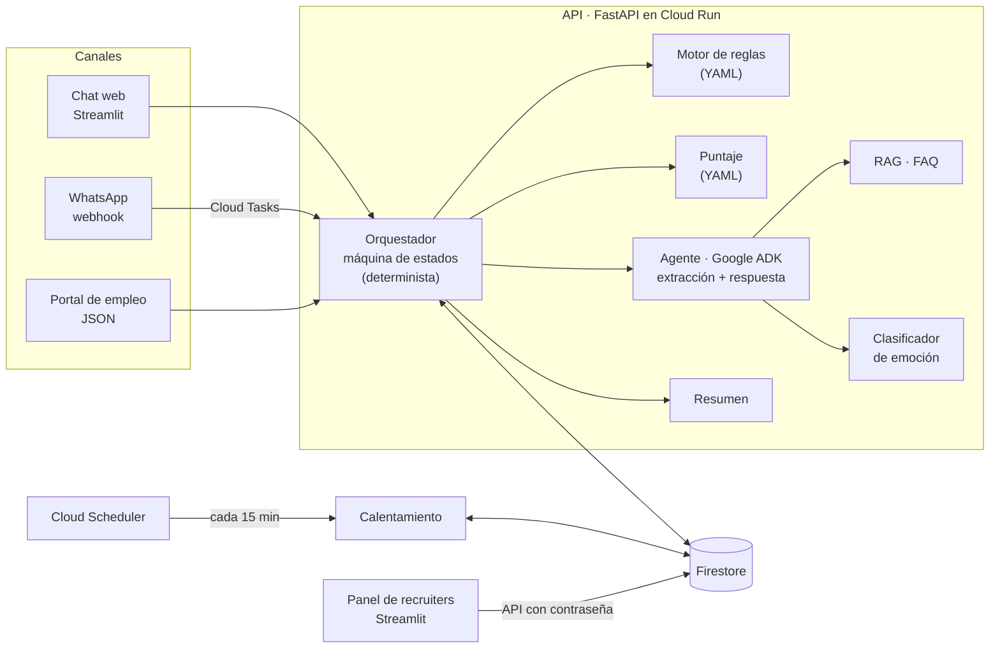

# Agente de screening de repartidores · Grupo Sazón

Agente conversacional que hace el primer filtro de candidatos a repartidor para Grupo Sazón
(45 locales en España y México, ~1.000 postulaciones por semana). Conversa con el candidato,
extrae y valida los datos, aplica las reglas eliminatorias, calcula un puntaje y deja una
ficha lista para el recruiter, con resumen, en un panel que se actualiza en vivo.

**Demo en vivo:** <https://screening-panel-tg6cgmz3wa-ew.a.run.app>
- **Postular (candidato)**, pública: pones nombre y país y conversas con Sofía, la asistente.
- **Panel (recruiter)**, con contraseña: la ficha se llena mientras conversas.

> El primer mensaje tras un rato sin uso tarda ~20 s (Cloud Run escala a cero para no cobrar).

| Documento | Contenido |
|---|---|
| [docs/fase1_diseno_proceso.md](docs/fase1_diseno_proceso.md) | Fase 1: diseño del proceso (etapas, personalidad, campos, casos borde) |
| [evals/datasets/](evals/datasets) | Golden datasets: casos de conversación por capacidad (extracción, respuesta, RAG, resumen, emoción) |
| [specs/](specs/README.md) | Una spec por feature (000–019): qué hace y cómo se prueba |
| [deploy/README.md](deploy/README.md) | Despliegue en GCP |
| [evals/README.md](evals/README.md) | Pipeline de evaluación con LLM-as-a-judge |

---

## 1. El problema y la solución

Hoy 13 recruiters hacen ~975 llamadas por semana para ~1.000 postulantes: **el 60% no
contesta** y **el 80% del tiempo restante se va en candidatos que no califican**. En la
práctica se habla con menos del 40% de los postulantes, tarde, mientras Glovo, Uber Eats y
Rappi compiten por el mismo talento.

El diagnóstico es de **canal, orden y velocidad**, no solo de "automatizar llamadas":

| Problema | Respuesta |
|---|---|
| El 60% no contesta llamadas | **Mensajería asíncrona** a los minutos de postular (WhatsApp en producción; chat web en el demo), con **calentamiento automático** si no responde: recordatorios por WhatsApp y SMS en horario hábil, configurables |
| El 80% del tiempo en no calificados | **Eliminatorias primero** (consentimiento, licencia compatible con el vehículo, ciudad con local): quien no califica sale en un minuto, sin tocar a un humano |
| Llegar tarde | El recruiter recibe una **cola de calificados ordenada por puntaje**, con resumen. Deja de filtrar y pasa a cerrar |

El recruiter solo interviene donde aporta: entrevistar y contratar.

## 2. Qué cubre

| Requisito del enunciado | Dónde |
|---|---|
| Agente conversacional que sigue el diseño de la Fase 1 | `src/screening/conversation/` (orquestador) + `src/screening/agent/` (Google ADK) |
| Salida JSON estructurada con todos los campos | `ScreeningData` en `src/screening/domain/models.py`; salida del LLM con JSON schema estricto y validada con Pydantic |
| Validación: rechazar con amabilidad y repreguntar | Campo inválido → repregunta con ejemplo; tras 2 intentos queda en `needs_review` y la conversación sigue |
| Historial completo | La ficha guarda cada mensaje y cada evento (`timeline`) en Firestore |
| Almacenamiento | Firestore (memoria en tests y desarrollo) |
| Resumen post-conversación | `src/screening/summary/`: datos clave desde la ficha + observaciones del LLM |
| Manejo de errores | Ningún error del LLM, la base o el canal tumba la conversación: se registra y se pide disculpas |
| Herramienta para recruiters | Panel en Streamlit: tabla paginada, ficha con conversación, JSON, puntaje y resumen, cambio de estado, métricas |

| Bonus | Estado |
|---|---|
| Multi-idioma ES/EN, con cambio de idioma a mitad de conversación | ✅ Responde en el idioma del último mensaje; vocabulario por país ("carnet"/"licencia", "coche"/"carro") |
| Guardrails | ✅ Las reglas nunca las decide el LLM; filtro de fugas de texto interno; opt-out ("no me escriban más") respetado; pedido de humano; FAQ sin inventar |
| Análisis de sentimiento | ✅ Clasificador con `gpt-5-nano` (frustrado / confundido / apurado / neutral) que ajusta el tono |
| Analítica | ✅ Completitud, abandono por etapa, motivos de descarte, duración, costo por candidato |
| Re-engagement | ✅ Cadencias en YAML (nunca respondió / abandonó a mitad), horario hábil por país, cancelación al responder |
| RAG sobre FAQ | ✅ Embeddings + umbral: si la respuesta no está en la FAQ, Sofía dice que lo consulta |
| Tests y evals | ✅ 845 tests unitarios + 6 suites con golden dataset y LLM-as-a-judge |
| Diseño de despliegue | ✅ Desplegado en Cloud Run, Firestore, Secret Manager, Scheduler y Cloud Tasks |
| Agente de voz · agendamiento · integración con ATS | ❌ Siguientes pasos (sección 8) |

## 3. Arquitectura



**Un turno de conversación:**
1. Llega el mensaje (chat web, o WhatsApp vía webhook → Cloud Tasks, que agrupa mensajes
   seguidos del mismo candidato).
2. El orquestador toma un **lease** por candidato en Firestore (dos instancias nunca procesan
   al mismo candidato a la vez).
3. **Turno de extracción** (LLM): normaliza lo que dijo ("tengo el carnet de coche hace 5
   años" → `license_type: "B"`, `license_years: 5`) y detecta idioma, emoción, opt-out,
   pedido de humano y preguntas.
4. **Reglas eliminatorias** (código, desde YAML): se evalúan apenas están sus campos. Si una
   falla, se envía la plantilla de descarte y se cierra.
5. **Turno de respuesta** (LLM, con el RAG como tool): Sofía redacta 1–3 líneas con una sola
   pregunta, en el idioma y el vocabulario del candidato, siguiendo lo que el orquestador
   decidió preguntar.
6. En el cierre: resumen para confirmar → puntaje → `qualified` → resumen para el recruiter.
7. Cada paso queda en la ficha y en su `timeline`: el panel lo ve en vivo.

```
src/screening/
  domain/        Modelos compartidos (ficha, estados, mensajes)
  config/        Esquemas Pydantic del YAML de negocio
  ports.py       Interfaces: repositorio, leases, LLM, agente, canales, FAQ
  intake/        Validación y normalización del JSON del portal
  rules/         Motor de reglas eliminatorias (lógica de tres valores)
  scoring/       Puntaje 0–100 con desglose
  conversation/  Orquestador (máquina de estados)
  agent/         Agente con Google ADK (extracción, respuesta, emoción)
  knowledge/     RAG sobre la FAQ
  summary/       Resumen post-conversación
  reengagement/  Calentamiento por índice next_touch_at
  channels/      WhatsApp, chat web, SMS simulado, consola
  tasks/         Cola de tareas (Cloud Tasks / local)
  api/           FastAPI: chat, webhook, postulaciones, tareas, API del panel
  adapters/      Firestore, memoria, OpenAI
  crm/           Streamlit: chat público + panel
config/          Reglas, puntaje, cadencias, regiones y plantillas (YAML)
prompts/         Prompts versionados
knowledge/       FAQ (ficticia) e índice de embeddings
evals/           Golden datasets, juez y métricas
```

## 4. Decisiones clave

**La lógica de negocio es código; el LLM solo conversa y normaliza.** Descartar a alguien o
calcular su puntaje no puede depender de un modelo: tiene que ser auditable ("¿por qué me
descartaron?" → una regla concreta) y reproducible. El LLM nunca decide una regla.

**Reglas, puntaje, cadencias y regiones en YAML.** Grupo Sazón cambia su proceso sin tocar
código, y cada cliente nuevo de Orbio es un YAML distinto, no un proyecto nuevo. Todo se valida
al arrancar (incluidas las referencias cruzadas): un YAML inválido no arranca el sistema.

**Dos turnos de LLM separados: extraer y responder.** El turno de extracción devuelve JSON con
esquema estricto y nunca habla con el candidato; el de respuesta solo redacta. Así el mensaje
nunca filtra nombres de campos ni herramientas, y cada turno se evalúa por separado.

**LLM: OpenAI, con un modelo por rol y esfuerzo de razonamiento medido.**
- `gpt-5-mini` para extracción, respuesta y resumen; `gpt-5-nano` para la emoción.
- Salidas estructuradas con JSON schema estricto, buen español de España y México, y costo
  bajo: **~$0,007–0,011 por candidato** con la conversación completa.
- El esfuerzo de razonamiento se eligió con las evaluaciones: `minimal` baja la latencia a
  ~2 s por llamada sin perder calidad en respuesta, resumen, emoción y RAG; la extracción
  necesita `low` (con `minimal` perdía correcciones y la confirmación del cierre).
- Todo es configurable en `config/client.yaml`, y el LLM está detrás de una interfaz: cambiar
  de proveedor no toca la lógica.

**Google ADK como capa de agentes**, con OpenAI vía `LiteLlm`. ADK aporta la estructura
(agentes, tools, runner) y un camino estándar de despliegue en GCP. Cada llamada es sin estado:
el historial sale de la ficha en Firestore, que es la única fuente de verdad.

**Escalable por diseño**, aunque sea un demo (sección 7): procesos sin estado, concurrencia
resuelta en la base con leases, consultas por índice y paginación, trabajo diferido con colas.

**Datos en la UE.** Una sola base Firestore en `europe-west1` para ES y MX: cumple GDPR y la
ley mexicana no exige residencia local. En producción iría una base por país; el código ya
está preparado (el repositorio está detrás de una interfaz).

**Chat web en el demo en lugar de WhatsApp.** WhatsApp está implementado y probado (webhook
con firma, deduplicación, agrupación con Cloud Tasks, plantillas fuera de la ventana de 24 h),
pero el demo no depende de una cuenta de Meta. El canal es intercambiable: el mismo
orquestador atiende ambos.

**Evaluación custom con LLM-as-a-judge.** Golden datasets de pregunta + respuesta esperada por
suite, con un juez que también se evalúa a sí mismo (`judge_sanity`), y métricas de accuracy,
latencia y costo.

## 5. Calidad

- **845 tests unitarios** sin red ni LLM (fakes en las interfaces), más tests de integración
  contra Firestore y OpenAI reales que se saltan sin credenciales. `ruff` en lint y formato.
- **Evaluaciones contra OpenAI real** (`python -m evals.run --suite <nombre>`):

| Suite | Casos | Accuracy | Latencia p50 | Qué evalúa |
|---|---|---|---|---|
| `extraction` | 28 | 100% | 4,5 s | Mensaje → campos normalizados (ES, MX, EN, ambiguos, correcciones, opt-out) |
| `reply` | 10 | 100% | 2,3 s | Pedido del orquestador → mensaje de Sofía (tono, largo, una pregunta) |
| `summary` | 8 | 100% | 1,7 s | Ficha + conversación → resumen sin inventar datos |
| `sentiment` | 22 | 95,5% | 0,8 s | Mensajes → emoción (ironía, mayúsculas, mensajes cortos) |
| `rag` | 15 | 93,3% | 1,4 s | Preguntas de la FAQ y preguntas que no están (debe reconocerlo) |
| `judge_sanity` | 10 | 100% | — | El juez aprueba paráfrasis y reprueba contradicciones |

- **Punta a punta con servicios reales:** la conversación completa contra Firestore y OpenAI
  termina calificada; esta prueba encontró dos bugs que los tests con fakes no veían (ver los
  commits `fix:`).

## 6. Cómo correrlo en local

Requisitos: Python 3.12 y una API key de OpenAI.

```bash
py -3.12 -m venv .venv
.venv\Scripts\python -m pip install -e ".[dev]"
copy .env.example .env      # completar OPENAI_API_KEY y PANEL_PASSWORD
```

```bash
# Conversar con el agente real en la consola, sin servidor
.venv\Scripts\python scripts\chat_console.py

# API (chat web, panel, postulaciones) en http://localhost:8000
.venv\Scripts\uvicorn screening.api:create_app_from_env --factory --port 8000

# Chat público + panel en http://localhost:8501 (en otra terminal)
.venv\Scripts\streamlit run src\screening\crm\app.py

# Tests y lint
.venv\Scripts\python -m pytest
.venv\Scripts\python -m ruff check . && .venv\Scripts\python -m ruff format --check .

# Evaluaciones (llaman a OpenAI)
.venv\Scripts\python -m evals.run --suite extraction
```

Por defecto todo corre en memoria; con `SCREENING_REPOSITORY=firestore` usa Firestore. El
despliegue en GCP está en [deploy/README.md](deploy/README.md).

## 7. Cómo escala a 10.000 postulaciones por semana

10K por semana son ~1.400 por día, con picos tras publicar avisos. Lo que ya está resuelto:

- **Sin estado en los procesos.** Cloud Run escala horizontalmente; todo el estado vive en
  Firestore.
- **Concurrencia entre instancias** con un lease por candidato (transacción en Firestore), en
  vez de locks en memoria.
- **Nada recorre todas las fichas.** El calentamiento consulta por el índice `next_touch_at`
  paginando; el panel pagina con cursor y cuenta por estado con agregaciones.
- **Trabajo diferido con colas.** Los mensajes de WhatsApp se agrupan con Cloud Tasks (con
  reintentos y backoff si el candidato está ocupado); el calentamiento corre con Cloud
  Scheduler.
- **Costo de LLM:** ~$0,01 por candidato → **~$100 por semana** a 10K, frente a 13 recruiters
  llamando.

Lo que habría que agregar a ese volumen:
- **WhatsApp:** pasar del límite de 250 conversaciones iniciadas por día al tier de 10K
  (verificación del negocio en Meta) y plantillas aprobadas para los recordatorios.
- **Métricas:** contadores agregados al guardar, o export a BigQuery, en vez de calcular sobre
  una ventana de fichas recientes.
- **Una base por país** (ES en Europa, MX en `northamerica-south1`).
- **Límite de tasa** en los endpoints públicos (Cloud Armor) y tareas con token OIDC.

## 8. Mejoras con más tiempo

Con honestidad, en orden de impacto:

1. **Latencia.** Hoy un turno tarda 8–12 s. Bajar la ventana de agrupación de WhatsApp (8 s →
   3 s), saltar el LLM en respuestas triviales ("sí", "ok") cuando se espera un sí/no, y
   mostrar "escribiendo…" en WhatsApp. Medirlo con las evaluaciones.
2. **WhatsApp real** con la cuenta de Meta del cliente (el código está listo: `deploy.ps1
   -WhatsApp`).
3. **Agendamiento de entrevistas** al calificar (Google Calendar / Calendly) y **integración
   con el ATS** del cliente (webhook al cambiar a `qualified`).
4. **Agente de voz** para quien prefiere hablar: la "boca" cambia, el orquestador es el mismo.
5. **Evals en CI** con un subconjunto barato en cada PR, y más casos sacados de conversaciones
   reales que fallen.
6. **Guardrail adicional** fuera del prompt (moderación de entrada y salida).
7. **Contenido real:** la FAQ y los rangos de pago son ficticios; la tabla de licencias está
   simplificada y la zona se valida solo por ciudad (no por barrio ni distancia).

## 9. Cómo se construyó

Spec-driven development: cada feature parte con su spec en [`specs/`](specs/README.md), luego
tests y luego código, siempre con tests unitarios y, si usa LLM, con su golden dataset. El
desarrollo se hizo con IA (Claude Code) en olas paralelas: primero los contratos compartidos
(dominio, interfaces, YAML) y después varias features a la vez, cada una en su rama y su PR,
integradas y verificadas juntas. Las reglas de trabajo están en [CLAUDE.md](CLAUDE.md).
