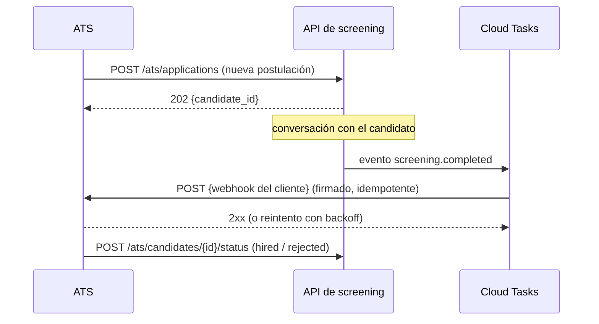

# Integración con un ATS — diseño

**Estado:** diseño (bonus "ATS integration design" del enunciado; no implementado).

## Objetivo

Que el agente no sea una isla: las postulaciones entran desde el ATS del cliente (Greenhouse,
Lever, Workable, SAP SuccessFactors, uno propio…) y los resultados del screening vuelven a él,
para que el recruiter siga trabajando en su herramienta de siempre. Nuestro panel queda como
vista operativa del agente, no como un segundo sistema de registro.

## Principios

- **El ATS es el sistema de registro del candidato; nosotros, del screening.** Cada ficha guarda
  el ID del ATS (`application.application_id`) y cada evento enviado lleva nuestro `candidate_id`.
- **Eventos, no sincronización total.** Enviamos cambios relevantes (calificado, descartado,
  entrevista agendada); no replicamos la base completa.
- **Un adaptador por ATS** detrás de una interfaz (`AtsClient`), igual que los canales: el
  núcleo no conoce Greenhouse ni Lever.
- **Entrega garantizada:** cada evento sale por Cloud Tasks con reintentos y backoff; una
  falla del ATS nunca bloquea la conversación.
- **Mínimo de datos personales:** solo se envía lo que el ATS necesita; el historial completo
  queda en nuestra base.

## Flujo



## 1. Entrada: postulaciones desde el ATS

Generaliza el `POST /applications` actual (spec 002) con autenticación y mapeo por ATS.

```yaml
POST /ats/applications
Authorization: Bearer <token del cliente>         # o mTLS / firma HMAC del ATS
Idempotency-Key: <id de la postulación en el ATS>
Content-Type: application/json

{
  "ats": "greenhouse",
  "application_id": "gh-882134",
  "job_id": "repartidor-madrid",
  "candidate": {
    "full_name": "Lucía Pérez",
    "phone": "+34600111222",
    "email": "lucia@example.com",
    "city": "Madrid",
    "country": "ES"
  },
  "consent": {"whatsapp_opt_in": true, "captured_at": "2026-10-26T09:12:00Z"}
}

→ 202 {"candidate_id": "6f3a…", "status": "contacted"}
→ 200 si ya existía (misma Idempotency-Key o mismo teléfono)
→ 422 si faltan datos obligatorios
```

El adaptador traduce el formato propio de cada ATS a este contrato (Greenhouse envía webhooks
`application_created`; Lever, `candidateStageChange`; otros se consultan por polling cada pocos
minutos si no tienen webhooks).

## 2. Salida: eventos del screening hacia el ATS

Un webhook por cliente, configurado en su YAML, con estos eventos:

| Evento | Cuándo | Acción típica en el ATS |
|---|---|---|
| `screening.started` | Primer contacto enviado | Mover a la etapa "En screening" |
| `screening.qualified` | Confirmó el resumen y pasó las eliminatorias | Mover a "Calificado", adjuntar puntaje y resumen |
| `screening.disqualified` | Falló una regla eliminatoria | Rechazar con el motivo |
| `screening.no_response` | Se agotó el calentamiento | Mover a "Sin respuesta" |
| `screening.opted_out` | Pidió no ser contactado | Marcar como no contactar |
| `interview.scheduled` / `interview.cancelled` | Agendamiento (spec 021) | Crear o cancelar la entrevista en el calendario del ATS |

```yaml
POST {webhook_url del cliente}
X-Orbio-Signature: sha256=<HMAC del cuerpo con el secreto del cliente>
X-Orbio-Event-Id: <uuid>          # idempotencia: el ATS ignora repetidos
Content-Type: application/json

{
  "event": "screening.qualified",
  "event_id": "c0ffee…",
  "occurred_at": "2026-10-26T09:31:04Z",
  "candidate_id": "6f3a…",
  "application_id": "gh-882134",
  "status": "qualified",
  "score": {"total": 92.5, "components": {"experience": 35, "availability": 25, "…": 0}},
  "screening": {
    "full_name": "Lucía Pérez",
    "has_license": true, "license_type": "B", "vehicle_type": "car", "owns_vehicle": true,
    "city": "Madrid", "availability": "full_time", "preferred_schedule": "flexible",
    "delivery_experience": {"years": 2, "platforms": ["Glovo"]},
    "start_date": "2026-11-02", "work_permit": true
  },
  "summary": "Lucía Pérez · Madrid · Calificada · 92,5/100 …",
  "disqualification": null,
  "needs_review": [],
  "links": {"panel": "https://…/panel?candidate=6f3a…"}
}
```

- **Entrega:** Cloud Tasks con hasta 10 reintentos (2 s → 30 min); después, el evento queda
  en una cola de "eventos fallidos" visible en el panel para reenviarlo a mano.
- **Orden:** cada evento lleva `occurred_at`; el ATS aplica el más reciente por candidato.

## 3. Entrada: cambios de estado desde el ATS

Para que el panel y las métricas reflejen el resultado final (contratado o rechazado tras la
entrevista):

```yaml
POST /ats/candidates/{application_id}/status
Authorization: Bearer <token del cliente>

{"status": "hired" | "rejected" | "interview", "reason": "…", "occurred_at": "…"}
→ 200 · queda en el timeline como `status_changed` con `source: ats`
```

## 4. Configuración por cliente (YAML)

```yaml
ats:
  provider: greenhouse            # greenhouse | lever | workable | custom
  inbound:
    auth: bearer                  # el token vive en Secret Manager
  outbound:
    webhook_url: https://ats.cliente.com/hooks/orbio
    signing_secret: secret://ats-signing-secret
    events: [screening.qualified, screening.disqualified, interview.scheduled]
  field_mapping:                  # nombres de campos propios del ATS
    license_type: custom_field_licencia
    delivery_experience.years: custom_field_experiencia
```

## 5. Seguridad y privacidad

- Tokens y secretos de firma por cliente en Secret Manager; rotación sin redeploy.
- Firma HMAC en ambos sentidos y verificación de la marca de tiempo (rechazar eventos con más
  de 5 minutos de antigüedad) contra ataques de repetición.
- Solo datos necesarios; el historial completo de la conversación no sale del sistema salvo
  que el cliente lo pida explícitamente.
- Borrado (GDPR): un evento `candidate.erased` desde el ATS borra la ficha y sus mensajes.

## 6. Esfuerzo estimado

| Pieza | Esfuerzo |
|---|---|
| Interfaz `AtsClient`, eventos y entrega por Cloud Tasks | 2–3 días |
| Endpoints de entrada con auth e idempotencia | 1–2 días |
| Primer adaptador (p. ej. Greenhouse) + mapeo de campos | 2–3 días |
| Panel de eventos fallidos y reenvío | 1 día |
